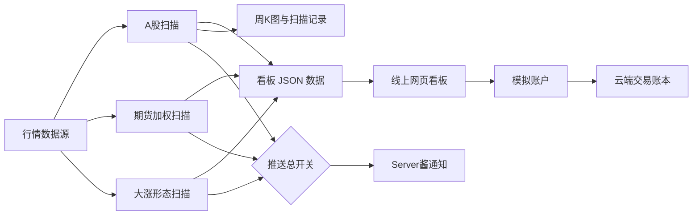

# 交易助手工具使用说明书

**版本**：v1.1.0
**适用看板版本**：v1.20.0
**更新日期**：2026-10-17

## 1. 这是什么工具

交易助手每天检查 A 股和国内期货的价格变化，并把需要留意的结果放在网页看板上。它提供两类风险提示：

1. **策略一：长期均线风险提示。** 查看 A 股是否从 60 周平均价下方重新站回线上，以及期货品种离长期平均价有多近。
2. **策略二：大涨后追高风险提示。** 查看突然大涨、回踩或突破的股票，帮助使用者注意追高风险。

看板还提供 K 线图、历史记录、数据状态、AI 辅助评价和模拟账户记账。

> **重要：看板不是交易软件。** 它不会连接券商下单。策略一和策略二都是风险提示，不是买入推荐，也不保证未来收益。模拟账户只记录虚拟交易。

## 2. 打开看板

打开：[交易助手看板](https://ma60-alert-dashboard.app.workbuddy.host/)

页面底部有四个入口：

| 入口 | 用途 |
|---|---|
| **策略一** | 查看 A 股 60 周线提醒、期货提醒和全部期货品种 |
| **策略二** | 查看大涨、回踩和突破形态的追高风险提醒 |
| **系统** | 查看数据日期、覆盖情况、自动任务、推送状态和 AI 使用记录 |
| **我的** | 登录模拟账户，记录虚拟买卖并复盘 |

点入口切换页面。策略一和策略二都可以上下滚动查看更多内容。

## 3. 先看页面顶部

- **数据日期**：显示看板所用数据的最新日期。盘中扫描结果可能比当天收盘数据早。
- **推送状态提示**：如果看到“推送已停用”，表示手机通知开关关闭；看板和数据扫描仍可照常使用。
- **数据快照提示**：如果远端数据暂时无法连接，看板会改用发布时自带的数据，并显示快照日期。刷新页面后会重新尝试连接；提示消失前，名单可能缺少最近新增结果。

使用名单前先确认数据日期。尤其是盘中，不要把前一轮扫描当作当天最终结果。

## 4. 策略一：A 股与期货提醒

### 4.1 A 股提醒怎么读

页面最上方先给一句总结：今天有多少只股票需要留意，或今天没有符合条件的股票。

当前 A 股触发条件是：

- 上一周收盘价低于 60 周线；
- 当前价格达到或高于 60 周线。

这说明股票从长期平均价下方重新站回线上。它**不代表股票已经转强**。历史统计显示，这类触发之后平均跑输全市场等权基准，因此页面把它列作**掉队风险提示**。手里已有相关股票时，可结合自己的计划检查风险；没有持仓时，不要只凭这条提示买入。

看板展示层会隐藏名称含 **ST** 或 **退** 的股票，并标出隐藏数量。原始扫描数据并没有因此删除。

股票列表每行显示股票名称、代码、现价和部分比较数据。页面上的排序按钮可按不同字段重新排列。点股票行可打开详情。

### 4.2 个股详情与走势图

详情窗口提供五种周期：

| 周期 | 主要用途 |
|---|---|
| **分时** | 查看当天价格、当日均价、昨收参考线和分钟成交量 |
| **日 K** | 查看每日开盘、最高、最低、收盘及成交量；默认展示最近 120 个交易日 |
| **周 K** | 查看每周走势；周 K 的 MA60 对应系统使用的 60 周线 |
| **月 K** | 查看每月走势 |
| **年 K** | 查看按年汇总的走势 |

K 线使用红涨绿跌配色。图中均线为 MA5、MA10、MA20、MA60；下方柱体表示成交量。可用滚轮或双指缩放，也可拖动查看历史。

注意：只有**周 K**中的 MA60 是系统触发判定使用的 60 周线。日 K 的 MA60 是 60 日平均价，不能拿它代替系统判定口径。图表来自项目现有行情接口，不直接抓取同花顺数据。

详情里的 **B / S** 标记表示你在模拟账户里记下的买入 / 卖出点，不是系统发出的交易信号。

### 4.3 期货提醒怎么读

策略一页面下方包含期货区域：

- **今天的期货品种提醒**：列出发生突破或接近 60 周线的品种。
- **每个品种离均线还有多远**：列出全部纳入监控的期货品种，便于比较。

期货价格使用持仓量加权方式合成，减少主力合约换月时的价格跳空对长期曲线的影响。系统把期货状态分成：

- **突破**：最新加权价达到或超过 60 周线。
- **临近**：尚未突破，且与 60 周线的偏离在正负 3% 范围内。

“临近”只是距离提示，不代表即将突破。期货页面同样不是买卖建议。

## 5. 策略二：大涨后的追高风险

本页把形态分成三组：

| 组别 | 页面名称 | 简要含义 |
|---|---|---|
| A | 今天突然大涨的 | 涨停，或放量大涨并创回踩段新高 |
| B | 涨完跌下来、跌不动的 | 大涨后回踩，近期卖压减弱 |
| C | 刚冲过前一次高点的 | 价格突破近期反弹高点 |

页面给出历史统计和筛除说明。历史回测中，启动阶段之后 60 日的超额中位数为负，因此本页的用途是**提醒不要因短期大涨而追高**，不是用来挑买入标的。

如果名单上方出现“数据停在某日”的提示，表示形态扫描尚未更新到今天；此时列表不是今天的完整扫描结果。点开“本次已排除”可查看被市值、名称、解禁或公告风险条件排除的标的。

## 6. 最近一个月的历史记录

策略一首页如有历史摘要，可点 **看明细** 进入“最近一个月”页面。历史页可以：

- 按日期查看每天的触发数量；
- 按股票查看触发记录；
- 搜索股票代码、名称或行业；
- 筛选当前仍在 60 周线上方或已回到线下的记录；
- 点记录打开周 K 图。

历史记录用于回顾，不代表该股票今天仍满足触发条件。

## 7. 系统页面

### 数据是否新、是否完整

查看“数据最新到哪天”“正在盯着的股票”和覆盖率等项目。新股上市时间不足 61 周时，还没有足够数据计算 60 周平均价，因此暂时不会进入这项监控；数据足够后会自动纳入。

系统在交易日自动进行盘中扫描、收盘复核和数据更新。页面显示的运行流水用于确认任务是否执行。任务状态显示成功，表示工作流完成；如需排查某个扫描时段是否真正命中，还要看对应的任务日志。

### 推送额度和当前开关

系统页面显示推送额度及开关状态。**当前定时推送已开启**，A 股、期货和收盘形态提醒会按任务配置发送。推送走 Server酱通道，每日额度有限；看见扫描结果不等于一定发送成功，任务记录与推送额度可用于辅助核对。

### AI 调用记录与开关

AI 五维评价默认暂停。暂停时不会请求 AI 模型，也不会消耗模型 Token。

如要使用 AI：

1. 在系统页的“AI 调用记录”区域选择恢复使用。
2. 打开任意个股详情，点 **生成 AI 五维评价**。
3. 按向导选择模型、填写自己的 API Key，并先测试连通。

也可以在首次向导中点 **免配置试用 · 先逛逛**，先使用其他页面。只有点生成评价或测试连通时才会调用模型；模型服务可能按量计费。API Key 保存在当前浏览器，不会由本看板服务器保存。更换浏览器或设备时需要重新配置。

AI 评价仅作辅助参考。调用时间、请求类型和 Token 数记录在当前浏览器的本地存储中，最多保留 50 条；“清空记录”只清除本机记录。

### 自动任务列表

系统页默认显示最近 3 条任务。点“还有更早的任务”可展开，再点一次可收起。展开状态保存在当前浏览器。

## 8. “我的”：模拟账户

此功能只做虚拟记账，不会提交真实委托。登录方式为手机号验证码。首次使用时发送验证码并完成登录 / 注册。

模拟账户默认本金为 **100 万元**。登录后可查看现金、持仓、盈亏、资产曲线和交易记录。手机和电脑登录同一账户时使用同一份云端账本。

### 记录一笔买入或卖出

1. 在“我的”页点 **记一笔交易**，或在股票详情里点买入 / 卖出。
2. 选股票，填写成交价和股数。
3. 可选填写买卖理由标签和备注。
4. 检查页面显示的成交金额、预估费用和可用现金，再点确认。

模拟规则：A 股股数必须为 100 股的整数倍；买入当日不能卖出（T+1）；佣金按万分之 2.5、最低 5 元估算，卖出另计印花税和过户费。费用用于模拟，不一定等于你的实际券商费率。

错误记录可从成交列表撤销。需要留存时点 **导出成表格**。退出登录不会删除云端账本。

## 9. 数据与更新节奏

- 行情和历史数据由项目配置的数据源生成；网页优先读取远端最新 JSON 文件。
- 远端暂时不可用时，页面会使用站点自带快照，并显示提示。此时刷新页面会重试远端。
- 盘中扫描时，A 股日线数据可能尚未更新到当天收盘；收盘复核和日线更新完成后，数据日期会推进。
- 看板列表会隐藏 ST / 退市风险名称，但策略二还有独立的市值、解禁和公告风险筛选。

### 9.1 定时推送是怎么安排的

推送总开关在 `config/alert_config.yaml` 的 `push.enabled`：**true = 正常发送**，
false = 只扫描与更新、不发送。扫描、看板、历史记录不受开关影响。

默认节奏（周一至周五）：

| 时刻 | 做什么 |
|---|---|
| 10:05 / 11:05 / 14:05 / 14:55 | 盘中扫描，有新触发才推送 |
| 15:15 | 收盘确认批（A 股 + 期货 + 形态 + 财经新闻） |
| 16:00 起 | 数据仓增量更新（不推送） |

同一时刻有多套调度在敲门（本机定时任务、云端计划任务、外接定时服务），
靠「槽位 + 当日已执行」闸门去重，后到者自动退出，不会重复发。

几条硬规则：

- **非交易日不推送**，也不占额度。
- Server酱免费额度 **5 条/天**，用尽后当天不再发送（消息会记录并跳过）。
- A 股、期货、形态都没有内容时，不推送；只有财经新闻时，默认**只在收盘确认轮**
  单独成条推送（避免盘中 4 个扫描槽把额度占满）。

### 9.2 推送里的「重要财经新闻」栏目

每天收盘确认的推送里，末尾会附一节「重要财经新闻」，来自三个公开来源：
**同花顺、金十数据、新浪财经**。每条给出：发布时间、来源、标题、摘要、原文链接。

- **排序**：先按重要程度（宏观政策、监管、利率、业绩、产业等关键词加权 +
  时效衰减），同类分值再按发布时间倒序。
- **合并**：同一事件被多家报道时合并为一条，保留**最早的发布时间**，
  并标出全部来源（如“3 家报道”）。同一来源占太多条时会自动让位给其它源。
- **失败不影响推送**：任一源抓取失败（超时、接口变更、网络不可达），
  栏目会在末尾写明是哪个源失败，其余来源照常输出；三个源全失败时栏目留空并说明。

栏目参数都在 `config/alert_config.yaml` 的 `news:` 段，常用项：

| 配置项 | 含义 | 默认 |
|---|---|---|
| `enabled` | 是否采集并附在推送里 | true |
| `sources.tonghuashun / jin10 / sina` | 逐个源的开关 | 全 true |
| `window_hours` | 只保留最近多少小时内的新闻 | 24 |
| `max_items` | 栏目最多几条 | 8 |
| `max_per_source` | 同一来源最多占几条（0 = 不限） | 5 |
| `sim_threshold` | 标题相似度达到多少算同一事件 | 0.62 |
| `push_alone` | 仅有新闻时是否单独推送（仅收盘确认轮） | false |

想单独看采集结果（不发推送）：`cd src && python -m alert.news --preview`。

## 10. 常见问题

| 现象 | 处理方法 |
|---|---|
| 页面一直显示加载中 | 等几秒后刷新；若仍未加载，检查网络。远端数据超时后应回退到站点快照；快照也不可用时需稍后重试。 |
| 页面提示使用快照 | 看板数据源暂时无法连接。可以继续查看，但先核对提示中的日期；之后刷新重试。 |
| 今天没有股票 | 可能是全市场扫描后没有符合条件的股票，也可能是当前数据尚未更新到今天。先看顶部日期和“最近一次结果”。 |
| 没收到手机通知 | 先看推送是否真的该发：非交易日不推送；A 股、期货、形态都无内容时也不推送（纯新闻只在收盘确认轮推）。再看 Server酱每日 5 条额度是否用尽，以及手机端是否取消了对该公众号的关注。 |
| K 线空白或分时失败 | 检查网络后关闭详情再打开，或刷新页面。分时数据仅在行情接口可用时显示。 |
| AI 按钮不可用 | 在系统页恢复 AI 使用，并检查模型、API Key 和测试结果；调用模型可能产生费用。 |
| 手机验证码登录失败 | 检查手机号和验证码，确认页面网络可访问云服务；过期后重新获取验证码。 |
| 模拟账户不能卖出 | 检查持仓数量、100 股整数倍和 T+1 规则；当天买入的股票要到下一交易日才能记卖出。 |

## 11. 项目结构与维护入口

### 项目怎样工作



- A 股扫描以 baostock 为主要历史数据源，部分行情会使用备用源；期货扫描使用期货合约数据和持仓量合成加权价格。
- GitHub Actions 按交易时段触发扫描、收盘复核和数据更新。扫描结果构建为 JSON，网页读取这些文件并显示结果。
- 周 K 图由扫描流程生成；个股弹层的日 K、周 K、月 K、分时图使用腾讯行情接口。年 K 从月 K 汇总。
- 模拟账户通过云端服务保存交易记录，与行情扫描和推送流程分开。
- 推送总开关控制 A 股、期货和形态通知。关闭时仍可扫描、构建看板和更新数据。

普通使用者不需要进入项目目录。以下内容供维护者定位功能：

| 路径 | 内容 |
|---|---|
| `dashboard/` | 网页界面、走势图、账户和静态数据文件 |
| `src/alert/` | A 股扫描、行情获取、推送和任务入口 |
| `src/fut/` | 期货品种清单、加权价格和期货扫描 |
| `src/pattern/` | 右侧反转形态扫描和筛选 |
| `src/dashboard/` | 将扫描状态构建成看板 JSON 数据 |
| `store/` | 云端使用的精简行情、历史与运行状态 |
| `config/` | 扫描、推送和研究参数；密钥不应写入受版本控制的配置文件 |
| `.github/workflows/alert.yml` | 云端自动任务定义 |
| `output/_uicheck/` | 项目回归探针和界面验证脚本 |
| `docs/` | 研究口径、数据源、部署和使用说明 |

在项目根目录执行本地命令前，先设置 Python 模块路径：

```powershell
$env:PYTHONPATH = "src"
python -m alert.run_alert --demo      # 本地演示，不发送通知
python -m alert.run_alert --scan      # 立即进行一次扫描
python -m alert.run_alert --confirm   # 立即进行一次收盘确认
python -m alert.run_alert --update    # 更新本地日线数据并重建快照
```

扫描和更新需要行情源、依赖及本地数据仓正常工作，运行时间可能较长。当前项目的 `push.enabled` 为 `true`；手动运行 `--scan` 或 `--confirm` 可能发送通知并占用每日额度。不要把这些命令当作看板刷新按钮；它们会执行真实数据扫描。

修改云端调度、密钥或发布流程前，请先阅读：

- [外接定时服务配置指南](外接定时服务配置指南_v1.0.1.md)
- [云端部署指南](云端部署指南_v1.0.0.md)
- [实时预警需求规格](实时预警需求规格_v1.0.0.md)
- [数据源选型报告](数据源选型报告_v1.1.0.md)
