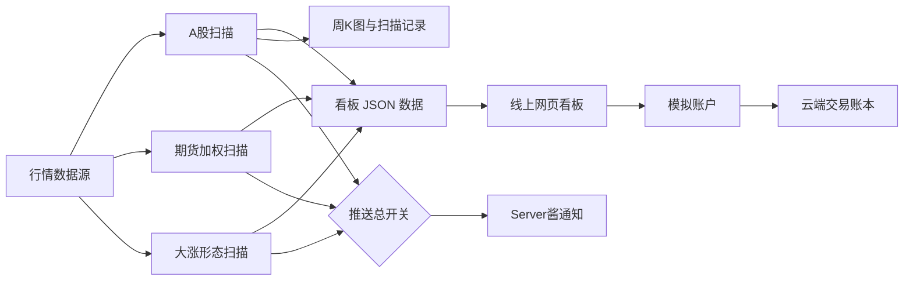

# 交易助手工具使用说明书

**版本**：v1.3.3
**适用看板版本**：v1.26.1
**更新日期**：2026-10-18

## 1. 这是什么工具

交易助手每天检查 A 股和国内期货的价格变化，并把需要留意的结果放在网页看板上。它提供两类风险提示：

1. **策略一：长期均线风险提示。** 查看 A 股是否从 60 周平均价下方重新站回线上，以及期货品种离长期平均价有多近。
2. **策略二：大涨后追高风险提示。** 查看突然大涨、回踩或突破的股票，帮助使用者注意追高风险。

看板还提供 K 线图、历史记录、数据状态、重要财经新闻和模拟账户记账。

> **重要：看板不是交易软件。** 它不会连接券商下单。策略一和策略二都是风险提示，不是买入推荐，也不保证未来收益。模拟账户只记录虚拟交易。

## 2. 打开看板

打开：[交易助手看板](https://ma60-alert-dashboard.app.workbuddy.host/)

页面底部有五个入口：

| 入口 | 用途 |
|---|---|
| **策略一** | 查看 A 股 60 周线提醒、期货提醒和全部期货品种 |
| **策略二** | 查看大涨、回踩和突破形态的追高风险提醒 |
| **新闻** | 独立的消息面板块：三条来源的重要财经新闻（不参与任何策略的选股） |
| **系统** | 查看数据日期、覆盖情况、自动任务和推送状态 |
| **我的** | 登录模拟账户，记录虚拟买卖并复盘 |

点入口切换页面。策略一和策略二都可以上下滚动查看更多内容。

> **新闻为什么是独立板块**：两条策略的名单只由价格和均线算出来，
> **不参考任何新闻**。新闻页只是帮你理解「今天为什么这样走」；
> 看到利空也不必据此改判策略信号，看到利好也不要把风险提示当买入理由。

## 3. 先看页面顶部

- **数据日期（v1.26.1 起分两栏）**：显示「扫描 <日期> · 周K库 <日期>」。
  「扫描日」是最近一次扫描用的行情日期（每个交易日多次）；「周K库日」是历史K线
  数据库整体归档到的最新收盘日（每个交易日 16:07 更新一次）。两者可能相差一天：
  扫描用的是「已归档周K + 当天行情」，名单始终按最新行情计算；只有周K库日落后
  **超过 1 个交易日**时才会标橙显示「滞后 N 个交易日」。
- **推送状态提示**：如果看到“推送已停用”，表示手机通知开关关闭；看板和数据扫描仍可照常使用。
- **数据快照提示**：如果远端数据暂时无法连接，看板会改用发布时自带的数据，并显示快照日期。刷新页面后会重新尝试连接；提示消失前，名单可能缺少最近新增结果。

使用名单前先确认数据日期。尤其是盘中，不要把前一轮扫描当作当天最终结果。

## 4. 策略一：A 股与期货提醒

### 4.1 A 股提醒怎么读

页面最上方先给一句总结：今天有多少只股票需要留意，或今天没有符合条件的股票。

当前 A 股触发条件是：

- 上一周收盘价低于 60 周线；
- 当前价格达到或高于 60 周线。

这说明股票从长期平均价下方重新站回线上。它**不代表股票已经转强**。历史统计显示，这类触发之后平均跑输全市场等权基准，因此页面把它列作**掉队风险提示**。手里已有相关股票时，可结合自己的计划检查风险；没有持仓时，不要只凭这条提示买入。

看板展示层会隐藏名称含 **ST** 或 **退** 的股票，并标出隐藏数量。原始扫描数据并没有因此删除。

股票列表每行显示股票名称、代码、现价和部分比较数据。页面上的排序按钮可按不同字段重新排列。点股票行可打开详情。

### 4.2 个股详情与走势图

详情窗口提供五种周期：

| 周期 | 主要用途 |
|---|---|
| **分时** | 查看当天价格、当日均价、昨收参考线和分钟成交量 |
| **日 K** | 查看每日开盘、最高、最低、收盘及成交量；默认展示最近 120 个交易日 |
| **周 K** | 查看每周走势；周 K 的 MA60 对应系统使用的 60 周线 |
| **月 K** | 查看每月走势 |
| **年 K** | 查看按年汇总的走势 |

K 线使用红涨绿跌配色。图中均线为 MA5、MA10、MA20、MA60；下方柱体表示成交量。可用滚轮或双指缩放，也可拖动查看历史。

注意：只有**周 K**中的 MA60 是系统触发判定使用的 60 周线。日 K 的 MA60 是 60 日平均价，不能拿它代替系统判定口径。图表来自项目现有行情接口，不直接抓取同花顺数据。

详情里的 **B / S** 标记表示你在模拟账户里记下的买入 / 卖出点，不是系统发出的交易信号。

### 4.3 期货提醒怎么读

策略一页面下方包含期货区域：

- **今天的期货品种提醒**：列出发生突破或接近 60 周线的品种。
- **每个品种离均线还有多远**：列出全部纳入监控的期货品种，便于比较。

期货价格使用持仓量加权方式合成，减少主力合约换月时的价格跳空对长期曲线的影响。系统把期货状态分成：

- **突破**：最新加权价达到或超过 60 周线。
- **临近**：尚未突破，且与 60 周线的偏离在正负 3% 范围内。

“临近”只是距离提示，不代表即将突破。期货页面同样不是买卖建议。

## 5. 策略二：大涨后的追高风险

本页把形态分成三组：

| 组别 | 页面名称 | 简要含义 |
|---|---|---|
| A | 今天突然大涨的 | 涨停，或放量大涨并创回踩段新高 |
| B | 涨完跌下来、跌不动的 | 大涨后回踩，近期卖压减弱 |
| C | 刚冲过前一次高点的 | 价格突破近期反弹高点 |

页面给出历史统计和筛除说明。历史回测中，启动阶段之后 60 日的超额中位数为负，因此本页的用途是**提醒不要因短期大涨而追高**，不是用来挑买入标的。

如果名单上方出现“数据停在某日”的提示，表示形态扫描尚未更新到今天；此时列表不是今天的完整扫描结果。点开“本次已排除”可查看被市值、名称、解禁或公告风险条件排除的标的。

## 6. 最近一个月的历史记录

策略一首页如有历史摘要，可点 **看明细** 进入“最近一个月”页面。历史页可以：

- 按日期查看每天的触发数量；
- 按股票查看触发记录；
- 搜索股票代码、名称或行业；
- 筛选当前仍在 60 周线上方或已回到线下的记录；
- 点记录打开周 K 图。

历史记录用于回顾，不代表该股票今天仍满足触发条件。

## 7. 系统页面

### 数据是否新、是否完整

查看“数据最新到哪天”“正在盯着的股票”和覆盖率等项目。新股上市时间不足 61 周时，还没有足够数据计算 60 周平均价，因此暂时不会进入这项监控；数据足够后会自动纳入。

系统在交易日自动进行盘中扫描、收盘复核和数据更新。页面显示的运行流水用于确认任务是否执行。任务状态显示成功，表示工作流完成；如需排查某个扫描时段是否真正命中，还要看对应的任务日志。

### 推送额度和当前开关

系统页面显示推送额度及开关状态。**当前定时推送已开启**，A 股、期货和收盘形态提醒会按任务配置发送。推送走 Server酱通道，每日额度有限；看见扫描结果不等于一定发送成功，任务记录与推送额度可用于辅助核对。

### 自动任务列表

系统页默认显示最近 3 条任务。点“还有更早的任务”可展开，再点一次可收起。展开状态保存在当前浏览器。

## 8. “我的”：模拟账户

此功能只做虚拟记账，不会提交真实委托。登录方式为手机号验证码。首次使用时发送验证码并完成登录 / 注册。

模拟账户默认本金为 **100 万元**。登录后可查看现金、持仓、盈亏、资产曲线和交易记录。手机和电脑登录同一账户时使用同一份云端账本。

### 记录一笔买入或卖出

1. 在“我的”页点 **记一笔交易**，或在股票详情里点买入 / 卖出。
2. 选股票，填写成交价和股数。
3. 可选填写买卖理由标签和备注。
4. 检查页面显示的成交金额、预估费用和可用现金，再点确认。

模拟规则：A 股股数必须为 100 股的整数倍；买入当日不能卖出（T+1）；佣金按万分之 2.5、最低 5 元估算，卖出另计印花税和过户费。费用用于模拟，不一定等于你的实际券商费率。

错误记录可从成交列表撤销。需要留存时点 **导出成表格**。退出登录不会删除云端账本。

## 9. 数据与更新节奏

- 行情和历史数据由项目配置的数据源生成；网页优先读取远端最新 JSON 文件。
- 远端暂时不可用时，页面会使用站点自带快照，并显示提示。此时刷新页面会重试远端。
- 盘中扫描时，A 股日线数据可能尚未更新到当天收盘；收盘复核和日线更新完成后，数据日期会推进。
- 看板列表会隐藏 ST / 退市风险名称，但策略二还有独立的市值、解禁和公告风险筛选。

### 9.1 定时推送是怎么安排的

推送总开关在 `config/alert_config.yaml` 的 `push.enabled`：**true = 正常发送**，
false = 只扫描与更新、不发送。扫描、看板、历史记录不受开关影响。

默认节奏（周一至周五）：

| 时刻 | 做什么 |
|---|---|
| 09:35 / 10:15 / 13:30 / 14:20 | 盘中扫描，有新触发才推送 |
| 15:10 | 收盘确认批（A 股 + 期货 + 形态 + 财经新闻） |
| 16:00 起 | 数据仓增量更新（不推送） |

同一时刻有多套调度在敲门（本机定时任务、云端计划任务、外接定时服务），
靠「槽位 + 当日已执行」闸门去重，后到者自动退出，不会重复发。

几条硬规则：

- **非交易日推财经要闻**：五个槽位各一轮（09:35 / 10:15 / 13:30 / 14:20 / 15:10），
  每轮只推当日**新增**条目；无新增则该轮不推、不占额度。
- Server酱免费额度 **5 条/天**，用尽后当天不再发送（消息会记录并跳过）。
- A 股、期货、形态都没有内容时，不推送；只有财经新闻时，默认**只在收盘确认轮**
  单独成条推送（避免盘中 4 个扫描槽把额度占满）。

#### 9.1.1 手动推送一条到手机

除定时推送外，提供了一个明确的人工触发入口：随时向手机发一条自定义通知。
它复用 Server酱通道，并完整保留「开关 / 每日额度 / 重试 / dry-run」护栏。

```bash
# 发送一条自定义通知（标题必填，正文可省略）
python -m alert.run_alert --push --title "标题" --message "正文"

# 只验证链路、不实际发送（不占额度、不留记录）
python -m alert.run_alert --push --title "标题" --dry-run
```

返回结果会在控制台打印一行结构化 JSON（`{"ok","status","detail","remaining","dry_run"}`），
并据此设置进程退出码（成功 0 / 失败 1），便于脚本判断：

| `status` | 含义 | 是否真发 |
|---|---|---|
| `sent` | 已发送 | 是 |
| `dry_run` | dry-run 链路验证通过，未实际发送 | 否 |
| `empty` | 标题为空 | 否 |
| `no_key` | 未配置 Server酱 sendkey（本地 `alert_config.local.yaml` 或环境变量 `ALERT_SENDKEY`） | 否 |
| `disabled` | 总开关 `push.enabled=false` | 否 |
| `no_quota` | 今日 5 条额度已用尽 | 否 |
| `failed` | 网络错误或接口拒绝（已重试 3 次） | 否 |

`sendkey` 优先级：环境变量 `ALERT_SENDKEY` > `config/alert_config.local.yaml` 的
`serverchan.sendkey`（密钥不入库，仅存本地/云端 Secrets）。

### 9.1.2 把结果分享到微信群

每天收盘确认的推送末尾，会附一张**当日汇总长图**和看板链接，可以直接转发到微信群：

1. 手机上收到推送后，**长按汇总图 → 保存到相册**；
2. 打开微信，进入要分享的群，发送这张图；
3. 想让朋友看完整名单和周K图，把推送里的**看板链接**（带 `?date=` 参数）一并发进群。

长图内容：标题、日期与扫描模式、触发总数（已剔除 ST/退市整理股）、
偏离 60 周线最近的至多 20 只明细（涨红跌绿），底部保留
「本信号统计上是『掉队风险提示』而非买入机会」的声明。
图上**只显示前 20 只**，完整名单请看在线看板。

打开带 `?date=` 的分享链接时，如果那个日期不是看板当前数据日，
页面顶部会提示「这是一条 X 的分享；看板当前展示最新数据（Y）」——
这是正常现象，看板每天覆盖更新、不保留历史，想看当日完整情况以推送长图为准。

> 为什么用「保存图片再转发」而不是自动发进群：个人微信群没有官方发送接口，
> 自动化方案要么有封号风险、要么需要装额外 App。转发件方式零风险、零门槛
> （详见 `docs/微信群分享方案_v1.0.0.md`）。

### 9.2 推送里的「重要财经新闻」栏目

每天收盘确认的推送里，末尾会附一节「重要财经新闻」，来自三个公开来源：
**同花顺、金十数据、新浪财经**。每条给出：发布时间、来源、标题、摘要、原文链接。
同一份采集结果也会出现在看板**「新闻」独立板块**里（v1.26.0 起从策略一拆出，
导航第五选项目「📰 新闻」）—— 两端共用**同一套实现**
（`src/alert/news.py`），不会出现推送和看板口径不一致的情况。

- **排序**：按「重要度评分」从高到低，同分再按发布时间倒序。评分是**可量化**的，
  公式见下；看板「最新消息」与推送栏目共用同一套评分，因此两端顺序一致。
- **合并**：同一事件被多家报道时合并为一条，保留**最早的发布时间**，
  并标出全部来源（如“3 家报道”）。同一来源占太多条时会自动让位给其它源。
- **失败不影响推送**：任一源抓取失败（超时、接口变更、网络不可达），
  栏目会在末尾写明是哪个源失败，其余来源照常输出；三个源全失败时栏目留空并说明。

#### 9.2.1 「重要」财经新闻的量化评分标准

一条新闻的**重要度**由下面这个公式算出来（实现见 `src/alert/news.py` 的
`score_news`，全部权重都可在 `news:` 段调）：

```
最终分 S = 来源权重 W ×（基础分 BASE + 市场影响 S_imp + 传播热度 S_heat）× 时效因子 R
```

| 维度 | 含义 | 怎么算 | 默认权重 |
|---|---|---|---|
| `W` 来源权重 | 来源越权威，底分越高 | 合并后多家报道时取最高那家 | 同花顺/金十 1.0、新浪 0.9 |
| `BASE` 基础分 | 通过源初筛即有的底分 | 固定值 | 14 |
| `S_imp` 市场影响 | 宏观/产业事件命中 | 命中 K1(+3)/K2(+2)/标题K3(+2)，累计上限 `cap_impact` | 上限 12 |
| `S_heat` 传播热度 | 传得开不开 | 2×(同源报道数−1) + 4×(源侧标记重要)，上限 `cap_heat` | 上限 10 |
| `R` 时效因子 | 越新越热 | max(0.35, e^(−age_h/12))，半衰期 12h | — |

- **K1（宏观监管硬事件）**：美联储、降息/加息/降准、LPR、央行、政治局/国常会、证监会、
  财政部、关税、GDP/CPI/PPI/PMI、非农、汇率/人民币、MLF、社融…（命中 +3）
- **K2（市场产业）**：A股/港股/美股、黄金、原油、IPO、退市、财报/业绩、回购、减持、
  并购/重组、芯片/半导体、新能源、房地产、券商/银行、国债…（命中 +2）
- **K3（突发标记）**：突发/紧急/重磅/重要/辟谣/澄清/停牌核查/风险提示（仅看标题，+2）
- **源侧重要标记**：同花顺 `import=1`、新浪 `level∈{1,2}`、金十 `important` —— 直接 +4 热度分

**「重要」的判定**：最终分 `S ≥ important_threshold`（默认 18），**或**任一源编辑标记为重要。
过滤后不足 `min_items` 条时按分值补齐，避免关键词表偏窄导致栏目空白。看板卡片的
「重要」小红点也用同一阈值，因此和推送口径一致。

栏目参数都在 `config/alert_config.yaml` 的 `news:` 段，常用项：

| 配置项 | 含义 | 默认 |
|---|---|---|
| `enabled` | 是否采集并附在推送里 | true |
| `sources.tonghuashun / jin10 / sina` | 逐个源的开关 | 全 true |
| `window_hours` | 交易日只保留最近多少小时内的新闻 | 24 |
| `per_source` | 每个源最多抓多少条原始新闻 | 25 |
| `max_items` | 推送栏目最多几条 | 8 |
| `dashboard_max_items` | 看板「最新消息」最多几条 | 15 |
| `max_per_source` | 同一来源最多占几条（0 = 不限） | 5 |
| `sim_ratio` | 标题字符序列相似度达到多少算同一事件 | 0.62 |
| `sim_overlap` | 标题 2-gram 重合度达到多少算同一事件 | 0.38 |
| `timeout` | 单个源的网络超时（秒） | 12 |
| `section_title` | 栏目标题 | 重要财经新闻 |
| `push_alone` | 仅有新闻时是否单独推送（仅收盘确认轮） | false |
| `base_score` / `cap_impact` / `cap_heat` | 评分模型三档上限 | 14 / 12 / 10 |
| `important_threshold` | 重要度阈值（达此值即「重要」） | 18 |
| `recency_tau` / `recency_min` | 时效半衰期(h) / 因子下限 | 12 / 0.35 |
| `src_weight` | 各来源权重（0~1） | 同花顺/金十 1.0、新浪 0.9 |

想单独看采集结果（不发推送）：

```
python -m alert.news --preview      # 打印推送栏目
python -m alert.news --summary      # 打印「非交易日财经要闻汇总」
python -m alert.news --json         # 结构化输出（含各源状态与每条 score）
python -m alert.news --dashboard    # 只重建看板 news.json
```

### 9.3 非交易日的「财经要闻汇总」

调度逻辑（见 `.github/workflows/alert.yml`）：

- **交易日**（周一至五、且当天有行情）：保持原有流程 —— 盘中扫描 / 收盘确认 /
  数据更新 / 推送，新闻作为一节附在预警后面。
- **非交易日**（周末、节假日）：**跳过股票扫描**，改为**多轮财经要闻推送**——
  与交易日共用五个槽位（`news.off_day_rounds`，默认 09:35 / 10:15 / 13:30 / 14:20 /
  15:10），每轮刷新看板「最新消息」，并**单独推一条**（`【财经要闻】09:35 · 新增 N 条`）。

非交易日汇总的区别是：时间窗放宽到 `off_day_window_hours`（默认 48h，覆盖周末两天）、
每轮条数 `off_day_max_items`（默认 10）、每条展示重要度评分与口径说明。

增量规则（`off_day_incremental`，默认开）：**每一轮只推当日尚未推送过的条目**。
第 2~5 轮通常只补几小时内的新消息；某一轮没有新增，就不推送、不占额度。

幂等护栏：`store/state/news_marks.json` 记录 `{日期: {rounds: 已执行轮次, keys: 已推条目}}`，
配合 GitHub cron 抖动与外接定时服务的补触发，**同一轮不会重复推**。
若只想刷新看板不发推送，把 `news.off_day_push` 设为 false。
若只想跑汇总不发推送，把 `news.off_day_push` 设为 false。手动补跑：

```
python -m alert.run_alert --news        # 非交易日财经要闻汇总（刷新看板 + 按需推送）
```

### 9.4 名单里为什么没有 ST 股

推送名单会**剔除风险股**，判定规则集中在 `src/name_rule.py`（全项目唯一真源，
形态扫描、推送名单、看板展示三处共用同一口径）：

- **ST / \*ST**：只看**名称开头**。前缀里的 `*`（含全角 `＊`）、半角/全角空格、
  `·`、`-` 等排版变体会先剥掉，老写法 `SST`、`S*ST` 也算。
  只看前缀是为了避免误伤名称中间恰好含「ST」的正常股票。
- **退市整理**：名称以「退」结尾（如「元道退」）或含「退市」。
  这类股票改名后名称里没有 ST，只判 ST 会漏掉。

被剔除的股票**不进推送名单**，但看板「当日触发」仍按全量统计，展示层再隐藏，
所以两边数字可能不同 —— 这是预期行为，不是漏数。

## 10. 常见问题

| 现象 | 处理方法 |
|---|---|
| 页面一直显示加载中 | 等几秒后刷新；若仍未加载，检查网络。远端数据超时后应回退到站点快照；快照也不可用时需稍后重试。 |
| 页面提示使用快照 | 看板数据源暂时无法连接。可以继续查看，但先核对提示中的日期；之后刷新重试。 |
| 今天没有股票 | 可能是全市场扫描后没有符合条件的股票，也可能是当前数据尚未更新到今天。先看顶部日期和“最近一次结果”。 |
| 名单里看不到某只 ST 股 | 正常。ST/\*ST 与退市整理股不进推送名单，看板展示层也会隐藏（见 9.3）。 |
| 没收到手机通知 | 先看推送是否真的该发：非交易日只推财经要闻（多轮，无新增不推）；A 股、期货、形态都无内容时也不推送（纯新闻只在收盘确认轮推）。再看 Server酱每日 5 条额度是否用尽，以及手机端是否取消了对该公众号的关注。 |
| K 线空白或分时失败 | 检查网络后关闭详情再打开，或刷新页面。分时数据仅在行情接口可用时显示。 |
| 历史版本的「AI 五维评价」去哪了 | v1.24.0 起该功能已整体移除，不再有任何大模型 API Key 的配置与调用；看板其余功能不受影响。 |
| 手机验证码登录失败 | 检查手机号和验证码，确认页面网络可访问云服务；过期后重新获取验证码。 |
| 模拟账户不能卖出 | 检查持仓数量、100 股整数倍和 T+1 规则；当天买入的股票要到下一交易日才能记卖出。 |

## 11. 项目结构与维护入口

### 项目怎样工作



- A 股扫描以 baostock 为主要历史数据源，部分行情会使用备用源；期货扫描使用期货合约数据和持仓量合成加权价格。
- GitHub Actions 按交易时段触发扫描、收盘复核和数据更新。扫描结果构建为 JSON，网页读取这些文件并显示结果。
- 周 K 图由扫描流程生成；个股弹层的日 K、周 K、月 K、分时图使用腾讯行情接口。年 K 从月 K 汇总。
- 模拟账户通过云端服务保存交易记录，与行情扫描和推送流程分开。
- 推送总开关控制 A 股、期货和形态通知。关闭时仍可扫描、构建看板和更新数据。

普通使用者不需要进入项目目录。以下内容供维护者定位功能：

| 路径 | 内容 |
|---|---|
| `dashboard/` | 网页界面、走势图、账户和静态数据文件 |
| `src/alert/` | A 股扫描、行情获取、推送和任务入口 |
| `src/fut/` | 期货品种清单、加权价格和期货扫描 |
| `src/pattern/` | 右侧反转形态扫描和筛选 |
| `src/dashboard/` | 将扫描状态构建成看板 JSON 数据 |
| `src/name_rule.py` | 个股名称风险判定（ST / 退市），形态、推送、看板共用 |
| `store/` | 云端使用的精简行情、历史与运行状态 |
| `config/` | 扫描、推送和研究参数；密钥不应写入受版本控制的配置文件 |
| `.github/workflows/alert.yml` | 云端自动任务定义 |
| `output/_uicheck/` | 项目回归探针和界面验证脚本 |
| `docs/` | 研究口径、数据源、部署和使用说明 |

在项目根目录执行本地命令前，先设置 Python 模块路径：

```powershell
$env:PYTHONPATH = "src"
python -m alert.run_alert --demo      # 本地演示，不发送通知
python -m alert.run_alert --scan      # 立即进行一次扫描
python -m alert.run_alert --confirm   # 立即进行一次收盘确认
python -m alert.run_alert --update    # 更新本地日线数据并重建快照
```

扫描和更新需要行情源、依赖及本地数据仓正常工作，运行时间可能较长。当前项目的 `push.enabled` 为 `true`；手动运行 `--scan` 或 `--confirm` 可能发送通知并占用每日额度。不要把这些命令当作看板刷新按钮；它们会执行真实数据扫描。

修改云端调度、密钥或发布流程前，请先阅读：

- [外接定时服务配置指南](外接定时服务配置指南_v1.0.1.md)
- [云端部署指南](云端部署指南_v1.0.0.md)
- [实时预警需求规格](实时预警需求规格_v1.0.0.md)
- [数据源选型报告](数据源选型报告_v1.1.0.md)
